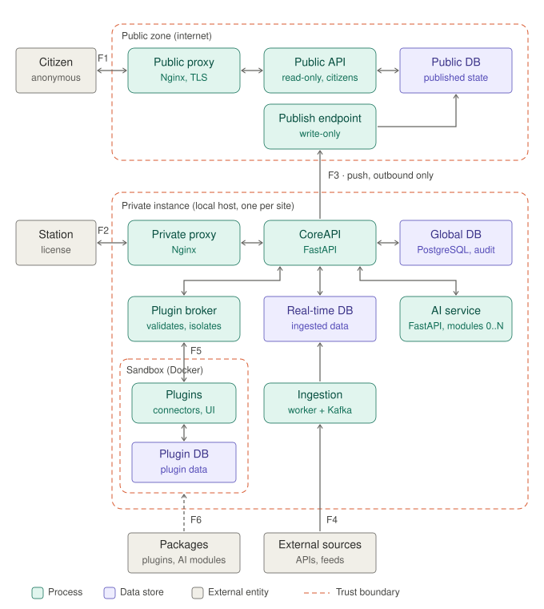

# Threat Model

## Introduction

This document is the threat model of the Ad Omnia platform. It identifies how data moves through the platform, where trust changes along the way, which threats matter most and how they are mitigated. It is built in four steps, each in its own section:

1. **Data flow diagram:** elements, flows and trust boundaries.
2. **STRIDE analysis:** threats for every flow that crosses a trust boundary.
3. **Priority threats:** the threats with the highest risk and their mitigations.
4. **Residual risks:** what remains after mitigation and why it is accepted.

## Assumptions

- **The architecture is public.** All project documentation is published, so the model assumes an attacker knows every component, flow and technology choice. No control depends on the design being secret.
- **Two deployments.** The architecture diagram shows a single backend, but the platform is deployed twice: a private application and a public application on the internet. Data flows only from private to public, and the private application accepts no inbound connection from the public side.
- **Private instances are locally hosted.** Every private application instance is hosted locally where it is used and accessed only locally; there is no remote access. Instances are independent of each other, and all of them push to the single public deployment.
- **Minimal public side.** The public deployment has its own database, which holds only the published state (validated incidents and public warnings); operational data never reaches it. It runs two separate processes: a read-only API for citizens and a write-only publish endpoint for private instances, each with a database account limited to what it needs. Private instances never connect to the public database directly.
- **Stations authenticate by license.** Each station uses a software license, stored in the User table as a slow, salted hash. In this initial phase, licenses are issued by the project team.
- **Plugins are untrusted.** Plugins run in a sandbox and reach the core only through the plugin broker. Plugins only expose data; they provide no user interface or frontend code, and the web application renders their data with its own components.
- **External data enters through the ingestion worker.** External sources are fetched by the ingestion worker, outside the plugin sandbox.
- **Prediction modules are internal.** The AI service's specialized modules are developed by the project team and delivered with the platform; they are not installed from third parties.
- **Prototype deployment.** In the academic prototype, the private and public deployments run on the same host. Docker networks reproduce the trust zones: no public container is attached to a private network, and CoreAPI publishes through the public proxy's host port, using the same path, HTTPS and API key as in a real deployment.

## Data Flow Diagram

### Diagram

Flows labeled F1 to F6 cross a trust boundary and are analyzed with STRIDE in the next step, together with F14 (license issuance), which is not drawn.

### Elements

| Element | Type | Zone |
| --- | --- | --- |
| Citizen | External entity | Internet |
| Station | External entity | Control room |
| External sources | External entity | Third parties |
| Packages (plugins, AI modules) | External entity | Supply chain |
| Public proxy | Process | Public zone |
| Public API (read-only) | Process | Public zone |
| Publish endpoint (write-only) | Process | Public zone |
| Public DB | Data store | Public zone |
| Private proxy | Process | Private instance |
| CoreAPI (including plugin gateway and plugin manager) | Process | Private instance |
| AI service (including specialized modules) | Process | Private instance |
| Ingestion (worker and Kafka) | Process | Private instance |
| Plugin broker | Process | Private instance |
| Global DB (including audit log) | Data store | Private instance |
| Real-time DB | Data store | Private instance |
| Plugins | Process | Sandbox |
| Plugin DB | Data store | Sandbox |

### Trust boundaries

| ID | Boundary | What it separates |
| --- | --- | --- |
| TB1 | Internet ↔ public zone | Anonymous, untrusted citizens from the public service |
| TB2 | Station ↔ private instance | The station's browser from the locally hosted backend; this is where the license authenticates the station |
| TB3 | Private → public | Each private instance from the internet-facing deployment; outbound only |
| TB4 | External sources → private instance | Third-party data the project does not control from the operational core |
| TB5 | Core ↔ sandbox | Untrusted plugin code from the core; the plugin broker is the control point |
| TB6 | Supply chain → private instance | Code entering the system: plugins, AI modules and dependencies |

### Data flows

#### Flows that cross a trust boundary

| Flow | From → to | Content | Boundary |
| --- | --- | --- | --- |
| F1 | Citizen ↔ public proxy | HTTPS read requests | TB1 |
| F2 | Station ↔ private proxy → CoreAPI | Operations (incidents, orders, decisions), real-time COP updates | TB2 |
| F3 | CoreAPI → publish endpoint | Validated incidents and public warnings, pushed by each private instance | TB3 |
| F4 | External sources → ingestion | Data feeds fetched over HTTPS | TB4 |
| F5 | Plugin broker ↔ plugins | Requests from the core, normalized data | TB5 |
| F6 | Packages → sandbox and AI service | Installation and updates of plugins and prediction modules | TB6 |
| F14 | License issuance → User table | Creation and revocation of station licenses | TB2 |

#### Internal flows

| Flow | From → to | Content |
| --- | --- | --- |
| F7 | Plugins ↔ Plugin DB | Plugin-specific data |
| F8 | CoreAPI ↔ Global DB | Core entities, audit log |
| F9 | CoreAPI ↔ Real-time DB | Latest ingested data |
| F10 | Ingestion → Real-time DB | Normalized observations |
| F11 | CoreAPI ↔ AI service | Prediction, recommendation and simulation requests |
| F12 | CoreAPI ↔ plugin broker | Calls from the plugin client |
| F13 | Public API ↔ Public DB | Published state |
| F15 | Publish endpoint → Public DB | Published state |

Internal flows stay inside a single trust zone. They are not analyzed separately, but their protections (for example, database permissions or service-to-service authentication) are part of the mitigations in later steps.

### Differences from the architecture diagram

- **Private and public deployments are separate.** The architecture diagram does not show how the public application receives data; here every private instance pushes (F3) to a write-only publish endpoint, separate from the read-only API that serves citizens. Writing directly to the public database was rejected: it would expose the database to the internet, place write credentials in every instance and leave the public side with no point at which to validate, authenticate or audit what is published.
- **Supply chain is explicit.** Plugins, and the prediction modules and dependencies delivered with each release, are code that enters the running system, so their delivery is modeled as its own flow (F6).
- **Plugin data reaches the station's browser.** Plugins only expose data, but that data is displayed in the station's browser through the plugin gateway, so content from the least trusted zone ends up in the most trusted one (F5 and F2).
- **License issuance is modeled.** License issuance is not part of the architecture diagram. Licenses are issued by the project team, so issuance is included as F14, and its procedure is defined in PT10.

## STRIDE Analysis

### Method

Each flow that crosses a trust boundary (F1 to F6 and F14) is analyzed with STRIDE per interaction: the threats consider the flow itself and the two elements at its ends. Each threat has an identifier in the form `<flow>-<category><number>`, which the following sections use to refer to it. Categories that do not apply to a flow are listed with the reason.

| Category | Property violated |
| --- | --- |
| **S**poofing | Authentication |
| **T**ampering | Integrity |
| **R**epudiation | Non-repudiation |
| **I**nformation disclosure | Confidentiality |
| **D**enial of service | Availability |
| **E**levation of privilege | Authorization |

### F1: Citizen ↔ public proxy (TB1)

| ID | Category | Threat |
| --- | --- | --- |
| F1-S1 | Spoofing | A fake website imitates the public application and spreads false emergency information or phishing during a crisis. |
| F1-T1 | Tampering | Responses are modified in transit if TLS is missing or can be downgraded. |
| F1-T2 | Tampering | Filter and search parameters are used to inject queries into the public API or database. |
| - | Repudiation | Not applicable: citizens are anonymous and only read data. |
| F1-I1 | Information disclosure | Public responses include internal-only fields or operationally sensitive detail, such as exact locations or resource positions. |
| F1-I2 | Information disclosure | Access logs, analytics or third-party scripts collect personal data from citizens, such as IP addresses or location. |
| F1-I3 | Information disclosure | Error messages or debug endpoints expose stack traces, versions or configuration. |
| F1-D1 | Denial of service | A traffic peak or a DDoS attack during a major emergency makes the application unavailable when it is most needed. |
| F1-D2 | Denial of service | Expensive filter combinations exhaust the public API or database. |
| F1-E1 | Elevation of privilege | A vulnerability in Nginx, FastAPI or a dependency gives an attacker control of the public host. |

### F2: Station ↔ private proxy → CoreAPI (TB2)

| ID | Category | Threat |
| --- | --- | --- |
| F2-S1 | Spoofing | A license copied from a station's configuration is used on another machine. |
| F2-S2 | Spoofing | Another process or user on the host calls the local API directly, bypassing the web application. |
| F2-S3 | Spoofing | A website open in the station's browser sends requests to the local API, through cross-site requests or DNS rebinding against `localhost`. |
| F2-T1 | Tampering | Script injected through ingested data or data returned by a plugin runs in the station’s browser and performs actions as the station. |
| F2-T2 | Tampering | Operational requests (incidents, orders, decisions) are replayed or modified between the browser and the backend. |
| F2-T3 | Tampering | The API allows an audit, order or decision record to be changed or deleted after it is created. |
| F2-R1 | Repudiation | Actions are attributed to a station, not to a person, so the audit log cannot show who in the control room made a decision. |
| F2-R2 | Repudiation | A station denies having issued an order or made a decision, and the audit log cannot prove otherwise because its records are incomplete or their integrity cannot be verified (see F2-T3). |
| F2-I1 | Information disclosure | Exported maps and data files leave the control room with operational information and are shared further than intended. |
| F2-I2 | Information disclosure | Permissive CORS or WebSocket origin checks let other local origins read the operational picture. |
| F2-D1 | Denial of service | Heavy historical searches or simulations exhaust resources and slow down the COP, alerts and orders. |
| F2-D2 | Denial of service | Rate limiting or lockout after failed license attempts blocks a legitimate station during an emergency. |
| F2-E1 | Elevation of privilege | Routes exposed through the plugin gateway are reachable without license checks. |
| F2-E2 | Elevation of privilege | Every station can perform every action, including publishing to the public application, so one compromised station has full control. |

### F3: CoreAPI → publish endpoint (TB3)

| ID | Category | Threat |
| --- | --- | --- |
| F3-S1 | Spoofing | An attacker impersonates a private instance and publishes false incidents or warnings, causing panic or misinformation. |
| F3-S2 | Spoofing | The private instance pushes to a fake public endpoint (DNS or certificate attack) and leaks published data or credentials. |
| F3-T1 | Tampering | Published messages are modified in transit. |
| F3-T2 | Tampering | Old messages are replayed, for example to reopen a closed incident or restore an ended warning. |
| F3-T3 | Tampering | A compromised private instance publishes falsified data that the public side accepts as authentic. |
| F3-R1 | Repudiation | The public side cannot show which instance and station published, changed or ended a warning. |
| F3-I1 | Information disclosure | The push serializes whole entities instead of the public schema, so operational fields cross the boundary. |
| F3-I2 | Information disclosure | Publisher credentials stored on the public side are stolen and reused (enables F3-S1). |
| F3-D1 | Denial of service | When the public side is down or slow, the private application blocks while publishing. |
| F3-D2 | Denial of service | When the private side is offline, citizens see outdated data without knowing it. |
| F3-E1 | Elevation of privilege | A compromised public side uses the response channel (replies, redirects, error bodies) to attack the private instance, or a design change introduces a pull from public to private. |
| F3-E2 | Elevation of privilege | An authorized instance changes or ends incidents and warnings published by another instance. |

### F4: External sources → ingestion (TB4)

| ID | Category | Threat |
| --- | --- | --- |
| F4-S1 | Spoofing | A fake or compromised source delivers false incidents or resource positions. |
| F4-T1 | Tampering | Feed content carries injection payloads that reach the COP, the database or exports. |
| F4-T2 | Tampering | Manipulated historical data poisons the training data of the prediction models. |
| F4-R1 | Repudiation | Without the raw payload and fetch metadata, it is not possible to prove what a source actually sent. |
| F4-I1 | Information disclosure | Outbound requests reveal the control room's network address, location and activity patterns to source operators and observers. |
| F4-I2 | Information disclosure | API keys for external sources leak through logs, configuration or the public repository. |
| F4-D1 | Denial of service | A source stops responding or responds very slowly. |
| F4-D2 | Denial of service | A source sends oversized or very frequent payloads that saturate Kafka or the Real-time DB. |
| F4-E1 | Elevation of privilege | A parser vulnerability gives code execution in the ingestion worker, which has write access to the Real-time DB. |

### F5: Plugin broker ↔ plugins (TB5)

| ID | Category | Threat |
| --- | --- | --- |
| F5-S1 | Spoofing | A plugin impersonates another plugin, or claims to feed sources it does not own. |
| F5-T1 | Tampering | A plugin writes false core data, such as incidents or resource positions, and corrupts the COP. |
| F5-T2 | Tampering | A plugin returns data with injection payloads that run as script when the web application displays it (see F2-T1). |
| F5-R1 | Repudiation | Data cannot be traced to the plugin and version that produced it. |
| F5-I1 | Information disclosure | A plugin requests more core data than it needs and sends it out through network access. |
| F5-I2 | Information disclosure | A plugin reads another plugin's data in the Plugin DB. |
| F5-D1 | Denial of service | A plugin exhausts CPU, memory or disk, or responds slowly and blocks core calls. |
| F5-D2 | Denial of service | A plugin floods the broker with requests. |
| F5-E1 | Elevation of privilege | A plugin escapes its container. Docker containers share the host kernel, so they are not a strong isolation boundary by default. |
| F5-E2 | Elevation of privilege | A plugin bypasses the broker by reaching CoreAPI, the AI service, Kafka or the databases directly over the container network. |

### F6: Packages → sandbox and AI service (TB6)

| ID | Category | Threat |
| --- | --- | --- |
| F6-S1 | Spoofing | A fake plugin, or a dependency with a look-alike name, is installed in place of the intended one. |
| F6-T1 | Tampering | A package or update is modified at the source or during download. |
| F6-T2 | Tampering | A legitimate plugin is replaced by a malicious update. |
| F6-R1 | Repudiation | There is no record of who installed or approved a plugin or module, or which version. |
| F6-I1 | Information disclosure | A package contains code that collects and sends out data (see F5-I1). |
| F6-D1 | Denial of service | A faulty update breaks the instance, and the control room may be offline when a fix is needed. |
| F6-E1 | Elevation of privilege | A prediction module or model file altered during build or delivery runs code when loaded inside the AI service, outside the sandbox. |

### F14: License issuance → User table (TB2)

| ID | Category | Threat |
| --- | --- | --- |
| F14-S1 | Spoofing | Licenses are guessable or derived from public information, so an attacker can create a valid one. |
| F14-T1 | Tampering | Anyone with write access to the database inserts their own license hash and gains access. |
| F14-R1 | Repudiation | There is no record of who issued or revoked a license. |
| F14-I1 | Information disclosure | Licenses are delivered through an insecure channel, such as plain email. |
| F14-D1 | Denial of service | A lost, expired or revoked license locks a station out during an emergency, with no fast recovery. |
| - | Elevation of privilege | Covered by F14-S1 and F14-T1. |

### Internal flows

The internal flows are not analyzed one by one, but two observations carry into the mitigations:
 
- **F11 (CoreAPI ↔ AI service)** is an HTTPS API. TLS protects the traffic but does not identify the caller: if the AI service does not authenticate who calls it, any container that can reach it, including a compromised plugin (F5-E2), can run predictions or load modules.
- **F8 and F9 (CoreAPI ↔ databases)** use credentials that, if shared with the ingestion worker or exposed to the plugin network, turn a compromise of those components into full database access (F4-E1, F5-E2, F14-T1).

## Priority Threats
 
### Method
 
Each threat from the STRIDE analysis is scored by probability and impact, on a scale from 1 to 3. The risk score is the product of the two, from 1 to 9.
 
| Score | Probability | Impact |
| --- | --- | --- |
| 1 (low) | Needs insider access, a rare vulnerability or several prior compromises | Limited; no effect on operations or on public information |
| 2 (medium) | Needs a specific weakness or a compromised component | Degrades operations or exposes non-critical data; recoverable |
| 3 (high) | Reachable by an external attacker with known techniques, or happens without an attacker (failure, misconfiguration) | Corrupts the operational picture, leaves the control room without the system during an emergency, spreads false information to citizens or exposes operational data |
 
Impact is measured by its operational consequences, not by the technical severity of the flaw. Because the architecture is public, probability assumes an attacker who knows the design.
 
Threats with a score of 6 or more are considered high risk. Related high-risk threats are grouped into priority threats (PT1 to PT10) that share the same mitigations. High-risk threats that are not part of a priority threat are listed in [Other high-risk threats](#other-high-risk-threats), with the reason.
 
### Risk scoring
 
**Treatment:** PT*n* = addressed by priority threat *n* (with Residual when part of the threat remains after mitigation); Other = high risk, see [Other high-risk threats](#other-high-risk-threats); Residual = accepted, see Residual Risks; — = low risk, addressed by general good practice.
 
| ID | Probability | Impact | Score | Treatment |
| --- | --- | --- | --- | --- |
| F1-S1 | 2 | 3 | 6 | Residual |
| F1-T1 | 1 | 2 | 2 | - |
| F1-T2 | 2 | 2 | 4 | - |
| F1-I1 | 1 | 3 | 3 | PT8 |
| F1-I2 | 2 | 2 | 4 | - |
| F1-I3 | 2 | 1 | 2 | - |
| F1-D1 | 3 | 3 | 9 | PT1, Residual |
| F1-D2 | 2 | 2 | 4 | PT1 |
| F1-E1 | 2 | 3 | 6 | Other |
| F2-S1 | 1 | 3 | 3 | - |
| F2-S2 | 1 | 3 | 3 | - |
| F2-S3 | 2 | 3 | 6 | PT3 |
| F2-T1 | 2 | 3 | 6 | PT4 |
| F2-T2 | 1 | 2 | 2 | - |
| F2-T3 | 2 | 3 | 6 | PT7, Residual |
| F2-R1 | 3 | 2 | 6 | Residual |
| F2-R2 | 2 | 3 | 6 | PT7 |
| F2-I1 | 2 | 2 | 4 | - |
| F2-I2 | 2 | 3 | 6 | PT3 |
| F2-D1 | 2 | 3 | 6 | Other |
| F2-D2 | 1 | 3 | 3 | - |
| F2-E1 | 2 | 3 | 6 | PT3 |
| F2-E2 | 2 | 3 | 6 | Residual |
| F3-S1 | 2 | 3 | 6 | PT2, Residual |
| F3-S2 | 1 | 2 | 2 | - |
| F3-T1 | 1 | 3 | 3 | PT2 |
| F3-T2 | 2 | 3 | 6 | PT2 |
| F3-T3 | 1 | 3 | 3 | PT2 |
| F3-R1 | 2 | 2 | 4 | PT2 |
| F3-I1 | 2 | 3 | 6 | PT8 |
| F3-I2 | 2 | 3 | 6 | PT2 |
| F3-D1 | 2 | 3 | 6 | Other |
| F3-D2 | 3 | 2 | 6 | Other |
| F3-E1 | 1 | 3 | 3 | - |
| F3-E2 | 2 | 3 | 6 | PT2 |
| F4-S1 | 2 | 3 | 6 | PT6, Residual |
| F4-T1 | 2 | 3 | 6 | PT4 |
| F4-T2 | 1 | 2 | 2 | - |
| F4-R1 | 2 | 1 | 2 | PT6 |
| F4-I1 | 3 | 2 | 6 | Residual |
| F4-I2 | 2 | 2 | 4 | - |
| F4-D1 | 3 | 2 | 6 | Other |
| F4-D2 | 2 | 2 | 4 | - |
| F4-E1 | 1 | 3 | 3 | - |
| F5-S1 | 1 | 2 | 2 | - |
| F5-T1 | 2 | 3 | 6 | PT6, Residual |
| F5-T2 | 2 | 3 | 6 | PT4 |
| F5-R1 | 2 | 2 | 4 | PT6 |
| F5-I1 | 2 | 3 | 6 | PT5 |
| F5-I2 | 1 | 2 | 2 | PT5 |
| F5-D1 | 2 | 3 | 6 | PT5 |
| F5-D2 | 2 | 2 | 4 | PT5 |
| F5-E1 | 1 | 3 | 3 | PT5, Residual |
| F5-E2 | 2 | 3 | 6 | PT5 |
| F6-S1 | 2 | 3 | 6 | PT9 |
| F6-T1 | 1 | 3 | 3 | PT9 |
| F6-T2 | 2 | 3 | 6 | PT9 |
| F6-R1 | 2 | 1 | 2 | PT9 |
| F6-I1 | 2 | 3 | 6 | PT5 |
| F6-D1 | 2 | 3 | 6 | PT9 |
| F6-E1 | 1 | 3 | 3 | - |
| F14-S1 | 1 | 3 | 3 | PT10 |
| F14-T1 | 1 | 3 | 3 | - |
| F14-R1 | 2 | 1 | 2 | PT10 |
| F14-I1 | 2 | 3 | 6 | PT10 |
| F14-D1 | 2 | 3 | 6 | PT10 |
 
### Priority threats
 
Priority threats are ordered by score. Among threats with the same score, those that reach citizens or the operational picture directly come first.
 
| ID | Priority threat | Threats | Score |
| --- | --- | --- | --- |
| PT1 | Public application unavailable during a crisis | F1-D1, F1-D2 | 9 |
| PT2 | False or unauthorized publication to citizens | F3-S1, F3-T1, F3-T2, F3-T3, F3-R1, F3-I2, F3-E2 | 6 |
| PT3 | Unauthorized access to the local API | F2-S3, F2-I2, F2-E1 | 6 |
| PT4 | Script injection from untrusted data | F2-T1, F4-T1, F5-T2 | 6 |
| PT5 | Plugin escapes its isolation | F5-I1, F5-I2, F5-D1, F5-D2, F5-E1, F5-E2, F6-I1 | 6 |
| PT6 | False operational data from sources and plugins | F4-S1, F4-R1, F5-T1, F5-R1 | 6 |
| PT7 | Audit and decision records altered | F2-T3, F2-R2 | 6 |
| PT8 | Operational data published to citizens | F1-I1, F3-I1 | 6 |
| PT9 | Compromised or faulty packages | F6-S1, F6-T1, F6-T2, F6-R1, F6-D1 | 6 |
| PT10 | Weak license lifecycle | F14-S1, F14-R1, F14-I1, F14-D1 | 6 |
 
### Mitigations
 
#### PT1: Public application unavailable during a crisis
 
**Threats:** F1-D1, F1-D2. **Risk:** 3 × 3 = 9.
 
Demand on the public application peaks during exactly the emergencies it exists for, and it is the most exposed component. Published data changes far less often than it is read, so most requests can be served without reaching the API.
 
- **Cached snapshots:** the public API generates the published state as precomputed responses, which the proxy caches and serves directly.
- **Bounded queries:** filters are limited to the indexed fields, results are paginated and queries have a maximum execution time.
- **Rate limiting:** the proxy limits requests per client and connections per address.
- **Multiple workers:** the read-only API runs several worker processes, so a slow request does not block the others.
- **Graceful degradation:** if the API is unavailable, the proxy serves the last cached snapshot with its timestamp.

These measures handle traffic peaks and small-scale attacks. A large-scale DDoS attack exceeds what a single academic deployment can absorb; it is discussed in Residual Risks.

#### PT2: False or unauthorized publication to citizens
 
**Threats:** F3-S1, F3-T1, F3-T2, F3-T3, F3-R1, F3-I2, F3-E2. **Risk:** 2 × 3 = 6.
 
A false warning or incident reaches the public directly and can cause panic or put people at risk. With several independent private instances, the publish endpoint must know exactly which instance sends each message and what it is allowed to change.
 
- **Per-instance key:** publishing is done automatically by CoreAPI, but the publish endpoint is reachable from the internet, so it must tell real instances apart from anyone else. Each instance's CoreAPI holds its own API key, generated by the project team and kept in the instance's configuration, never exposed to stations or the browser. The publish endpoint stores only a hash of each key and can revoke one instance without affecting the others (F3-S1, F3-I2).
- **HTTPS only:** the publish endpoint accepts only HTTPS, so messages cannot be read or modified in transit (F3-T1).
- **Ownership:** each published incident and warning belongs to the instance that created it; only that instance can update or end it (F3-E2), which also limits what a compromised instance can do (F3-T3).
- **Versioning:** each published item has a version number that increases with every change, and the endpoint ignores messages with a version older than the one it already has (F3-T2).
- **Publication log:** the endpoint records every message with the instance, the action and the time, so every change to the public state can be traced to an instance (F3-R1).

A leaked key still allows impersonating its instance until it is revoked; this is discussed in Residual Risks.

#### PT3: Unauthorized access to the local API
 
**Threats:** F2-S3, F2-I2, F2-E1. **Risk:** 2 × 3 = 6.
 
Being hosted locally does not protect the API from the station's own browser: any website open on the station can send requests to a local address, and DNS rebinding can make the browser treat a local address as the attacker's site.
 
- **Deny by default:** the license check is applied to every route, including the plugin gateway and WebSocket connections; routes must opt out explicitly. An automated test lists all routes and confirms that each one rejects requests without a valid session.
- **Host validation:** the proxy rejects requests whose `Host` header is not the instance's expected name, which defeats DNS rebinding.
- **Origin checks:** CORS allows only the application's own origin, never a wildcard, and WebSocket connections check the `Origin` header.
- **Session protection:** after license authentication, the session is kept in a `HttpOnly`, `SameSite=Strict` cookie, and state-changing requests require a CSRF token.
- **Network binding:** the proxy listens only on the interface the stations use, never on all interfaces.

#### PT4: Script injection from untrusted data
 
**Threats:** F2-T1, F4-T1, F5-T2. **Risk:** 2 × 3 = 6.
 
Text from external sources and plugins (incident descriptions, names, addresses) is displayed in the station's browser, which holds the station's session. Script that runs there can act as the station.
 
- **Output escaping:** all external text is rendered as text. React escapes by default; `dangerouslySetInnerHTML` is forbidden by a lint rule, and map popups and tooltips are built from text nodes, not HTML strings.
- **Content Security Policy:** a strict policy allows scripts only from the application itself, with no inline scripts.
- **Input validation:** the ingestion worker and the plugin broker validate every record against a schema with types, maximum lengths and allowed formats, and reject records that do not match.
- **Safe exports:** values in CSV exports that start with `=`, `+`, `-` or `@` are escaped, so exported files cannot run formulas in spreadsheet software.

#### PT5: Plugin escapes its isolation
 
**Threats:** F5-I1, F5-I2, F5-D1, F5-D2, F5-E1, F5-E2, F6-I1. **Risk:** 2 × 3 = 6.
 
A container on its own is not a sandbox. Plugin isolation depends on what the container can reach and what it is allowed to do.
 
- **Network isolation:** plugins run on an internal Docker network where the only reachable service is the plugin broker. There is no route to CoreAPI, the AI service, Kafka, the core databases or the internet. Since external data enters through the ingestion worker, plugins never need outbound access.
- **Container hardening:** plugins run as a non-root user with a read-only filesystem, all capabilities dropped, `no-new-privileges`, the default seccomp profile and no access to the Docker socket.
- **Resource limits:** each plugin has CPU, memory, process and disk limits, and the broker applies per-plugin rate limits and timeouts, so a slow plugin cannot block the core.
- **Least-privilege data access:** each plugin declares in its manifest the data it needs, and the broker only serves that data. Each plugin has its own schema and database user in the Plugin DB.
- **Separate service credentials:** the AI service only accepts requests from CoreAPI, authenticated with a service token, and each component (CoreAPI, ingestion worker, plugin broker) has its own database user with only the permissions it needs.

#### PT6: False operational data from sources and plugins
 
**Threats:** F4-S1, F4-R1, F5-T1, F5-R1. **Risk:** 2 × 3 = 6.
 
The operational picture is only as reliable as its inputs. False incidents or resource positions can lead to wrong decisions, and a compromised source or plugin cannot be fully prevented from sending them.
 
- **Provenance:** every observation records the source, the plugin and its version, and the ingestion time, and the ingestion worker keeps the raw payload with a hash.
- **Write scope:** the broker only accepts data from a plugin for the sources that plugin is registered to feed.
- **Basic plausibility checks:** positions outside the territory and impossible movement between updates are flagged instead of being applied silently.
- **Trust level on display:** each source's trust level and last update are shown with its data, and incidents from external sources need operator validation before they are published.
- **Fast disabling:** an operator can disable a source or plugin from the application, without a restart.

#### PT7: Audit and decision records altered
 
**Threats:** F2-T3, F2-R2. **Risk:** 2 × 3 = 6.
 
The audit log is the record of who did what during an emergency. If records can be changed, it proves nothing.
 
- **Append-only records:** the API has no update or delete operations for audit entries, issued orders or recorded decisions; corrections are new records that reference the original.
- **Database permissions:** the database user of CoreAPI has only `INSERT` and `SELECT` on these tables, and a trigger rejects `UPDATE` and `DELETE`.
- **Hash chain:** each audit entry includes the hash of the previous one, and the chain is verified on export, so changes made outside the API are detected.

Someone with full access to the database on the host could still rewrite the whole chain; this is discussed in Residual Risks.

#### PT8: Operational data published to citizens
 
**Threats:** F1-I1, F3-I1. **Risk:** 2 × 3 = 6.
 
The public database holds only what is published, so operational data can only reach citizens if it crosses the publish flow.
 
- **Explicit public schema:** the private instance converts each incident and warning into a dedicated public model with an allowlist of fields before publishing; whole entities are never serialized.
- **Strict validation on receipt:** the publish endpoint validates messages against the same schema and rejects unknown fields instead of ignoring them.
- **Location coarsening:** locations are reduced to an approximate area before publishing, and resource data has no place in the public schema.
- **Contract tests:** automated tests confirm that no internal field appears in the publish messages or in the public API responses.

#### PT9: Compromised or faulty packages
 
**Threats:** F6-S1, F6-T1, F6-T2, F6-R1, F6-D1. **Risk:** 2 × 3 = 6.
 
Plugins, prediction modules and their dependencies are code that runs inside the instance. A malicious or faulty update can reach a control room that may be offline when a fix is needed.
 
- **Pinned dependencies:** Python and JavaScript dependencies are pinned with hashes in lockfiles and scanned for known vulnerabilities in continuous integration.
- **Known sources:** plugins are installed only from the project's own repository, and each image is referenced by its digest, so a modified image is not installed under the same name.
- **Explicit updates:** nothing updates automatically. Each installation or update is an explicit action, recorded with the version, digest, date and station.
- **Rollback:** the previous version is kept, so a faulty update can be reverted locally without internet access.

#### PT10: Weak license lifecycle
 
**Threats:** F14-S1, F14-R1, F14-I1, F14-D1. **Risk:** 2 × 3 = 6.
 
The license is the only authentication of the private application, and its issuance, delivery and revocation are not part of the architecture, so they are defined here.
 
- **Strong licenses:** licenses are random values of at least 128 bits from a cryptographically secure generator, never derived from names or other public data, and are stored with Argon2id.
- **Secure delivery:** licenses are delivered in person or through a channel separate from the one that identifies the station, never by plain email.
- **Issuance register:** the project team keeps a register of every license issued and revoked, with the station, the date and who did it.
- **Emergency recovery:** a documented procedure, which works without internet access, issues a replacement license locally, so a lost license does not leave a station without the system during an emergency.

### Other high-risk threats
 
Some threats score 6 but are not part of a priority threat, because they are already handled by the platform's design or cannot be mitigated within it:
 
- **Covered by the availability design:** F2-D1 (simulations and heavy searches run in the AI service and in background jobs with their own resource limits, separate from the COP), F3-D1 (publishing is asynchronous through a local queue, so a slow public side never blocks the private instance), F3-D2 and F4-D1 (the public application and the COP show the time of the last update and flag outdated data).
- **Limited by the architecture:** F1-E1. A compromised public host has no path to private instances, and the read-only API's database account cannot change the published state. The host is kept patched and minimal, but an attacker in control of it could still show false data to citizens; this is treated as a residual risk.
- **Accepted:** F1-S1, F2-R1, F2-E2 and F4-I1 cannot be mitigated within the current design and are discussed in Residual Risks.

## Residual Risks
 
### Method
 
A residual risk is what remains after the mitigations of the priority threats, or a threat that cannot be mitigated within the current design. Each residual risk is scored again with the same scales, taking into account the mitigations and the compensating controls, which are mostly organizational and outside the application. Some of these limits come from the academic context of the project; [Production deployment](#production-deployment) lists what a real deployment should change.
 
| ID | Residual risk | Threats | Initial score | Residual score |
| --- | --- | --- | --- | --- |
| RR1 | Fake public application | F1-S1 | 6 | 6 |
| RR2 | All stations can perform all actions | F2-E2 | 6 | 4 |
| RR3 | Plausible false data from a legitimate source | F4-S1, F5-T1 | 6 | 4 |
| RR4 | Large-scale DDoS on the public application | F1-D1 | 9 | 3 |
| RR5 | Compromised public host | F1-E1 | 6 | 3 |
| RR6 | Actions attributed to stations, not people | F2-R1 | 6 | 3 |
| RR7 | Leaked instance key | F3-S1 | 6 | 3 |
| RR8 | Outbound requests reveal the control room | F4-I1 | 6 | 3 |
| RR9 | Container escape through the shared kernel | F5-E1 | 3 | 3 |
| RR10 | Audit chain rewritten with full database access | F2-T3 | 6 | 2 |
 
### Accepted risks
 
#### RR1: Fake public application
 
**Threats:** F1-S1. **Score:** 6 → 6.
 
Anyone can publish a website that imitates the public application, and nothing in the platform can prevent it. During a crisis, a convincing copy can spread false information or phishing.
 
- **Compensating controls:** the application is served from a single, stable address over HTTPS, and official channels link to it.

#### RR2: All stations can perform all actions
 
**Threats:** F2-E2. **Score:** 6 → 4.
 
By design, the license identifies the station and grants access to every function, including publishing to citizens. A compromised station has full control of its instance.
 
- **Compensating controls:** stations are only reachable locally, each one has its own license, every action is recorded in the audit log, and publication requires an explicit validation step.

#### RR3: Plausible false data from a legitimate source
 
**Threats:** F4-S1, F5-T1. **Score:** 6 → 4.
 
Plausibility checks catch impossible data, but a compromised or mistaken source can still send data that looks correct, such as an incident at a believable location.
 
- **Compensating controls:** each item shows its source, trust level and last update; incidents from external sources need operator validation before they are published; and an operator can disable a source immediately.

#### RR4: Large-scale DDoS on the public application
 
**Threats:** F1-D1. **Score:** 9 → 3.
 
Caching, rate limiting and bounded queries handle traffic peaks and small attacks, but a large-scale DDoS exceeds what a single academic deployment can absorb.
 
- **Compensating controls:** the last cached snapshot is served when the API is unavailable, and private instances keep working, since they never depend on the public side.

#### RR5: Compromised public host
 
**Threats:** F1-E1. **Score:** 6 → 3.
 
A vulnerability in the proxy, FastAPI or a dependency could give an attacker control of the public host. The architecture prevents any path to private instances, and the read-only API cannot change the published state, but an attacker in control of the host could still show false data to citizens.
 
- **Compensating controls:** the host runs only the public components, dependencies are pinned and scanned (PT9), and the published state can be restored from the private instances, which hold the original data.

#### RR6: Actions attributed to stations, not people
 
**Threats:** F2-R1. **Score:** 6 → 3.
 
By design, the license identifies the station, not the person using it, so the audit log cannot show who in the control room made a decision. This keeps operation simple in a room where several people share a station across shifts, and avoids storing personal data about operators.
 
- **Compensating controls:** the control room's own shift records show who was at each station, so the audit log's timestamps lead to the person; physical access to the room and stations is controlled; and each station has its own license, so attribution to the station is reliable.
- **Possible improvement:** an optional operator field (name or initials) on critical actions, such as decisions on recommendations and public warnings. It does not authenticate anyone, but it improves the audit trail.

#### RR7: Leaked instance key
 
**Threats:** F3-S1. **Score:** 6 → 3.
 
If an instance's API key leaks, anyone can publish as that instance until the key is revoked.
 
- **Compensating controls:** the key exists only in the instance's configuration and is never exposed to stations; ownership limits the attacker to the incidents and warnings of that instance; the publication log shows every change; and the key can be revoked without affecting other instances.

#### RR8: Outbound requests reveal the control room
 
**Threats:** F4-I1. **Score:** 6 → 3.
 
The ingestion worker fetches data from external sources, so source operators and observers can see the control room's network address and when it is active. The data fetched is public, so the requests reveal little beyond the fact that the address belongs to a control room.
 
- **Compensating controls:** requests carry no information that identifies the agency or the control room beyond the network address.

#### RR9: Container escape through the shared kernel
 
**Threats:** F5-E1. **Score:** 3 → 3.
 
Container hardening (PT5) makes escape much harder, but Docker containers share the host kernel, so a kernel vulnerability can still let a plugin reach the host.
 
- **Compensating controls:** plugins come only from the project's repository (PT9), run without privileges and have no network access beyond the broker, and the host kernel is kept updated.

#### RR10: Audit chain rewritten with full database access
 
**Threats:** F2-T3. **Score:** 6 → 2.
 
Someone with full access to the database on the host can change an audit entry and recompute the rest of the hash chain, which then verifies correctly.
 
- **Compensating controls:** this requires administrative access to the host, which the control room controls, and the API offers no way to change or delete records.
- **Possible improvement:** CoreAPI can periodically send the latest audit hash to the publish endpoint, which stores it in its publication log. A rewrite of the chain would then no longer match the stored hash. The hash reveals nothing about the audit log's contents.

### Production deployment

Some residual risks remain because of the academic context of the project, not because of the design. A production deployment should place the public application behind a provider with DDoS protection and a CDN (RR4), on a domain owned by the operating entity (RR1); replace instance API keys with per-instance certificates and mutual TLS (RR7); run plugins under a stronger sandbox, such as gVisor or separate virtual machines (RR9); and route outbound traffic through the operating entity's network (RR8).

### Out of scope
 
The security of the station hosts, their operating systems and the control room's network, as well as physical security, are the responsibility of the entity that operates each control room. The model assumes these are managed according to that entity's practices.
 
### Accepted low risks
 
Threats with a score below 6 that are not part of a priority threat are accepted. They are addressed by general good practice (input validation, TLS, patching, least privilege) and are not tracked individually.

